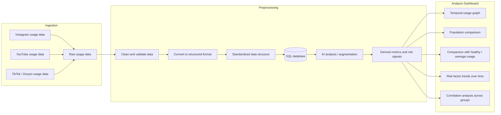

# LDiHK

## BUSINESS VIDEO

The BUSINESS VIDEO is at:

```text
https://youtube.com/shorts/t1Bc-_SUxZg
```

## Hosted Site

The website is hosted at:

```text
https://ldihk.xyz/
```

## Free Hosting

LDiHK runs entirely on free plans:

| Part | Provider | Config |
| --- | --- | --- |
| Frontend (Astro) | Netlify free | `Frontend/netlify.toml` (base directory `Frontend`), `Frontend/.env.example` |
| Backend API + import and enrichment workers | One Render free web service | `render.yaml`, `Dockerfile` |
| Postgres | Neon free | `DATABASE_URL` |
| Upload storage | Cloudflare R2 | `S3_ENDPOINT_URL`, bucket CORS + 1-day lifecycle rule |
| Video durations | YouTube Data API v3 | `YOUTUBE_API_KEY` |

The import and enrichment workers run as threads inside the web service
(`RUN_WORKERS_IN_PROCESS=true`), so no paid background workers are needed.
The Render free instance sleeps after 15 minutes without traffic; the
frontend shows a "waking the server" state while it starts (about a minute).

Setup steps, environment variables and limits are in
[docs/backend/deployment.md](docs/backend/deployment.md); frontend settings
are in [Frontend/README.md](Frontend/README.md).

Moving from the hackathon deployment (Render workers, Supabase, AWS S3): the
event dedupe key changed, so start with a fresh Neon database and re-upload
exports rather than copying old `usage_events` rows across.

## Release Workflow

`main` is the live site: Netlify deploys the frontend to ldihk.xyz and Render
deploys the API from it.

1. Work on a branch. Pushing it or opening a pull request creates a free
   Netlify branch deploy or deploy preview. Previews run on the mock API
   (`Frontend/netlify.toml`), so they cannot read or write live data.
2. Test real flows locally against a local backend (see Quick Start).
3. Only the project owner merges to `main`, after testing. That triggers the
   production deploys. Each Netlify production deploy costs 15 of the 300
   free monthly credits, so batch changes into releases: about 20 production
   deploys in a month use up the credits and pause every site on the account.
4. If a release adds a migration, run `python backend/scripts/run_migrations.py`
   against the production database right before merging it.

## Quick Start

Set up the local Python environment:

```sh
uv venv .venv
uv sync
```

Run the tests:

```sh
uv run python -m unittest discover -s backend/tests
```

Process the local Google Takeout export:

```sh
uv run python backend/scripts/process_youtube_usage.py
```

This writes:

```text
data/processed/users/local_user/youtube_usage.v1.json
```

Build the v3 SQLite usage store:

```sh
uv run python backend/scripts/import_youtube_usage_sql.py
```

This writes:

```text
data/processed/users/local_user/youtube_usage.v3.sqlite
```

Enrich v3 video durations when a YouTube Data API key is configured:

```sh
cp .env.example .env
# Set YOUTUBE_API_KEY in .env
uv run python backend/scripts/enrich_youtube_durations.py
```

Start the read-only API:

```sh
uv run flask --app backend.app run --host 127.0.0.1 --port 8000
```

Available endpoints:

```text
GET http://127.0.0.1:8000/health
GET http://127.0.0.1:8000/api/users/local_user/youtube-usage
GET http://127.0.0.1:8000/api/v2/users/local_user/youtube-usage/temporal
POST http://127.0.0.1:8000/api/v3/query
POST http://127.0.0.1:8000/api/query
POST http://127.0.0.1:8000/api/population
GET http://127.0.0.1:8000/api/me
POST http://127.0.0.1:8000/api/imports
GET http://127.0.0.1:8000/api/imports/{import_id}
```

The `/api/query`, `/api/population`, `/api/me` and `/api/imports` routes need
`DATABASE_URL` and an `Authorization: Bearer <LDiHK-ID>` header. Set
`RUN_WORKERS_IN_PROCESS=true` to process uploaded imports inside the API
process, or run `uv run python backend/scripts/run_worker.py` separately.

If `uv` cannot write to its default cache in a restricted environment, prefix commands with:

```sh
uv --cache-dir .uv-cache ...
```

## Frontend

The pulled frontend lives in `Frontend/`.

```sh
cd Frontend
npm install
cp .env.example .env
npm run dev
```

For the real backend, set:

```sh
PUBLIC_API_URL=http://127.0.0.1:8000
```

For local browser development, the backend CORS allowlist includes Astro's
default origin:

```text
http://localhost:4321
```

Leave `PUBLIC_API_URL` empty to use the frontend's local Astro mock API routes.

## Technical Diagram


